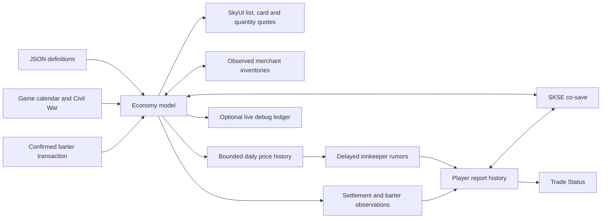

# Architecture

`src/core` is portable C++ with no game dependency. `Economy` owns the trading state; `Knowledge` owns information history and player reports. Their JSON records are independently versioned and validated before replacing live state. Fixed daily ticks and a serialized xorshift state make catch-up independent of batch size. Unsupported economy schemas fail rather than reset a running economy.

Schema 2 adds household goods. Loading schema 1 initializes the new commodity at the saved day when it is absent from every market and present in the current definitions. Established goods, prices, merchants, shipments, time and RNG state are preserved. Existing household stock in custom configurations is retained. Missing established goods, partially missing household stock and invalid values still reject the load without replacing live state. Schema 3 removes the contract state. Schema-1/2 trading and market fields are imported, with obsolete fields ignored; pre-0.1.8 DLLs cannot load schema 3.

Markets contain warehouses; merchant stock is separate. Both contribute to local availability. Production responds to storage, demand responds to price, food can spoil, and recipes consume inputs. Routes reserve stock when departing and deliver later, with losses decided and saved on departure. Taxes and NPC purchasing are explicit outside money sources; merchants spend cash to restock.

Each merchant item separates managed chest quantity from `externalQuantity`, observed in Skyrim's sale inventory through `ExtraOriginalReference` source handles. Shop displays and other sale sources contribute to availability but are never subject to simulated turnover or chest replenishment. The adapter validates the selected sale row's count, lets the engine choose the source, and accounts for the confirmed chest and external portions of the transfer separately. It preserves external counts between transactions because Skyrim's temporary sale inventory is being rebuilt. Opening the next barter session observes the external sources again. Older schema-1 saves default this new count to zero until observation.

The price function integrates stock change at unit midpoints, rounds each unit and sums the result. Symmetric trades retrace the curve before the merchant spread. `Config::BarterMultiplier` compresses the live game multipliers using a configurable exponent and a minimum margin on both sides. Speech, perks and merchant modifiers still affect offers. One `Price` method supplies all quotes. A confirmed `Trade` updates item counts, merchant cash and regional source/sink totals. There is no quote-time inventory mutation.

Regional `priceFactors` represent structural production costs and import dependence. Daily scarcity multiplies these factors; global bounds and adjustment limits still apply. New games seed their prices from the factors. Existing saved prices restore exactly and converge through ordinary ticks; the save schema is unchanged. Background customer receipts and warehouse purchases share the regional value scale, so import goods do not inherently drain merchant cash. Simulated cash stays within the ledger limit.

`src/runtime` adapts the model to Skyrim. Only game-thread tasks use game objects. A small timer requests work; it does not touch engine state. UI rendering reads a copied snapshot. A generation counter invalidates queued work after changing saves. Runtime form keys store the originating plugin and local ID, so load-order changes do not change identity; dynamic forms are excluded.

`Knowledge::Advance` wraps one-day advances without changing their order, RNG, prices or conditions, capturing each actual daily result. History is capped at 32 immutable samples. Observations copy regional rates; no UI lookup dereferences the live economy. Rumors use an incoming route's travel time to select an earlier sample, disclose a 20-percentage-point band and preserve both observation and acquisition dates. Selection uses a separate stable hash, never economy RNG. Each hold has one saved daily batch; fresher observations win. Route suggestions compare only remembered reports, using the destination's low bound and origin's high bound.

The existing `ECON` co-save record remains schema 3. A new `KNOW` record contains information schema 1 and is bounded to 4 MiB on load. Information restores after the game calendar is available. Rejected information is logged and discarded independently of `ECON`. Old saves have no knowledge to reveal; history starts at the restored economy day. Revert clears both objects and invalidates pending rumor callbacks. No engine form pointers or inventory objects are serialized by this feature.

The optional Trade Rumors ESL plugin adds a start-enabled dialogue quest, top-level branch, topic, seven INFOs and an availability global. A SEQ starts dialogue in existing games. It overrides no NPC, location or existing quest. Six mutually exclusive voice conditions select audited vanilla responses; the remaining voices use a generic shared response. DNAM references only response data, retaining the game's matching audio, subtitles and lip-sync without copying source scripts, links or quest actions. See [the voice mapping](RUMOR-VOICES.md). The propertyless INFO End fragment calls one native function after the response finishes. The native queues a generation-checked game-thread task, revalidates the nearby innkeeper, records the batch and opens CommonLib's standard message box after releasing the economy lock. The normal page requires SKSE Menu Framework; the rumor popup does not. No new vtable detours or raw runtime offsets are introduced.

The native integration targets desktop SE 1.5.97 and AE 1.6.x / 1.7.x using pinned alandtse CommonLib definitions. Both legacy Query and modern Version exports are provided, without a version whitelist. Inventory resets select SE ID 19375 or AE ID 19802; other hooks use CommonLib vtable IDs or paired relocations. `BarterMenu::Accept` redirects the `ItemSelect` callback. SkyUI method wrappers and a list data processor provide native quotes. Stock/gold are verified around the original callback; fractional unit-price rounding is reconciled only after observing the complete transfer. A detour on `TESObjectREFR::ResetInventory` protects registered merchant chests from vanilla replenishment. All these boundaries need in-game validation.

First-release limits: no per-mine simulation, service-price adapters, NPC household budgets, physical caravans, VR support. Commodity classification is broad and configurable; production and demand coefficients are starting balance choices. Plugin interoperability and economic balance are part of the game-test phase.
