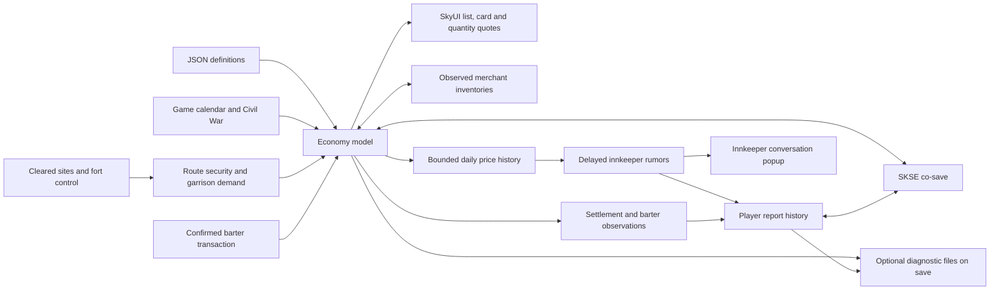

# Architecture

`src/core` is portable C++ with no game dependency. `Economy` owns the trading state; `Knowledge` owns information history and player reports. Their JSON records are independently versioned and validated before replacing live state. Fixed daily ticks and a serialized xorshift state make catch-up independent of batch size. Unsupported economy schemas fail rather than reset a running economy.

Schema 2 adds household goods. Loading schema 1 initializes the new commodity at the saved day when it is absent from every market and present in the current definitions. Established goods, prices, merchants, shipments, time and RNG state are preserved. Existing household stock in custom configurations is retained. Missing established goods, partially missing household stock and invalid values still reject the load without replacing live state. Schema 3 removes the contract state. Schema-1/2 trading and market fields are imported, with obsolete fields ignored; pre-0.1.8 DLLs cannot load schema 3.

Markets contain warehouses; merchant stock is separate. Both contribute to local availability. Production responds to storage, demand responds to price, food can spoil, and recipes consume inputs. The shipped recipes convert iron to steel; equipment production currently has no material requirements, and steel also has independent base production. Routes reserve stock when departing and deliver later, with losses decided and saved on departure. Taxes and NPC purchasing are explicit outside money sources; merchants spend cash to restock.

Daily retail sales are part of regional consumption, capped by that day's remaining demand. Turnover uses the integer portion plus a draw for the fractional portion of `quantity * merchantTurnover`. Affordable shop orders reserve up to 25% of daily demand from direct household consumption, with enough room for one indivisible item to accumulate. Restocking then spends actual warehouse stock and merchant cash, starting with the lowest stock/target ratio. Protected and external items do not participate. Warehouse spoilage follows retail, then recipes run before dispatch. Targets still come from the first observed inventory; no new merchandise is invented.

Offline experiments can enable `DailyStatistics` to collect requested and fulfilled demand, cargo departures, arrivals and transit losses. It consumes no random numbers, changes no decisions, and is never serialized. Runtime collection is off. The campaign harness uses this to distinguish unmet demand from merely low inventory.

With `balancedSeasons` enabled, seasonal production varies around the annual base rate instead of only falling below it. The amplitude is commodity `productionSwing` times regional `winterSeverity`. `WarehouseTarget` adds a reserve that peaks before winter and falls through the lean season. Its allowance is daily base demand times `reserveDays`, climate severity and the preparation curve; perishable allowances are capped at one quarter of shelf life. Production feedback and import requirements use this target. Pricing, starting inventories and the local export reserve retain the ordinary `Target`, so planning does not directly change a quote or create supplies. Both seasonal curves use the existing 365-day clock and offset. These plans are derived from the saved day and configuration, with no new serialized fields. Older configurations default to the previous seasonal rules. See [the seasonal experiment](SEASONAL-SIMULATION.md).

Daily dispatch plans all routes from one snapshot. Each market/commodity supplies a shared warehouse export budget and an import requirement net of expected incoming cargo. Each route supplies a capacity budget after disruption and security. Weighted progressive filling shares these budgets using missing units times proportional shortage, with a price-margin bonus capped at twofold. When one budget fills, its requests stop and the remaining requests share unused capacity. Roads and goods use stable ID ordering for shipment IDs and loss rolls; configuration order has no effect. The existing 60% export reserve and emergency replenishment below half the destination target remain. No new state is serialized by the allocator.

The broad Civil War disruption value reduces output and shipping capacity and increases shipping delays and loss risk. Route security is separate: it changes only transport capacity, delay, loss risk and the price-gap threshold for dispatch. Neither system currently fully closes a route. Commodity prices respond to their own availability and configured regional factors, not to the changing costs of recipe inputs.

`SecurityConfig` assigns named locations to directed routes. Hostile sites accumulate bounded pressure with diminishing returns; active military forts reduce that pressure and baseline shipping risk. Garrison demand is capped per market and commodity. Production has no security multiplier, though its existing response to inventory can change output indirectly. `ObserveSite` coalesces repeated observations within a day and schedules changes for the next daily tick. Catch-up therefore retains prior conditions until an observation becomes effective, and cargo already in transit retains its original ETA and reserved loss.

The runtime caches only configured location records, validates their keyword categories, and polls them on the game thread when advancing the economy. Camp profiles also require `LocTypeClearable`. It reads `IsCleared`, `CWFort` and `CWOwner`; it writes none of them. Vanilla `CWScript` excludes initial nonmilitary forts using `CWFort == -2` even though an owner is already assigned. `CWFort == 0` with owner 1 or 2 selects an Imperial or Stormcloak garrison. Negative owner values indicate a transfer in progress. Unknown values or mismatched tags are inactive. These adapters require live validation, especially with occupation overhauls.

The reviewed coverage catalog is `data/security-coverage.json`. `tools/build_security.py` divides each road's fixed threat budget among its mapped sites and writes symmetric forward/reverse exposures. This keeps cumulative pressure bounded when coverage expands. Coordinates support manual corridor review; runtime does not use straight-line distance to a capital. Six forts have unknown initial occupants and activate only when a recognized military state is observed. Solstheim's inland camps have no profile because the graph has only a sea link there.

Each merchant item separates managed chest quantity from `externalQuantity`, observed in Skyrim's sale inventory through `ExtraOriginalReference` source handles. Shop displays and other sale sources contribute to availability but are never subject to simulated turnover or chest replenishment. The adapter validates the selected sale row's count, lets the engine choose the source, and accounts for the confirmed chest and external portions of the transfer separately. It preserves external counts between transactions because Skyrim's temporary sale inventory is being rebuilt. Opening the next barter session observes the external sources again. Older schema-1 saves default this new count to zero until observation.

The price function integrates stock change at unit midpoints, rounds each unit and sums the result. Symmetric trades retrace the curve before the merchant spread. `Config::BarterMultiplier` compresses the live game multipliers using a configurable exponent and a minimum margin on both sides. Speech, perks and merchant modifiers still affect offers. One `Price` method supplies all quotes. A confirmed `Trade` updates item counts, merchant cash and regional source/sink totals. There is no quote-time inventory mutation.

Regional `priceFactors` represent structural production costs and import dependence. Daily scarcity multiplies these factors; global bounds and adjustment limits still apply. New games seed their prices from the factors. Existing saved prices restore exactly and converge through ordinary ticks; the save schema is unchanged. Background customer receipts and warehouse purchases share the regional value scale, so import goods do not inherently drain merchant cash. Simulated cash stays within the ledger limit.

`src/runtime` adapts the model to Skyrim. Only game-thread tasks use game objects. A small timer requests work; it does not touch engine state. A generation counter invalidates queued work after changing saves. Runtime form keys store the originating plugin and local ID, so load-order changes do not change identity; dynamic forms are excluded.

`Knowledge::Advance` wraps one-day advances without changing their order, RNG, prices or conditions, capturing each actual daily result. History is capped at 32 immutable samples. Observations copy regional rates into hidden report history. Rumors use an incoming route's configured travel time to select an earlier sample. The stored report uses a 20-percentage-point band; the conversation describes prices qualitatively. Both observation and acquisition dates are preserved. Selection uses a separate stable hash, never economy RNG. Each hold has one saved daily batch; fresher observations win.

The `ECON` co-save record now uses schema 4, adding site controls and pending dated observations. Older schemas acquire an empty security state; their existing trading data is preserved. Pre-0.5.0 DLLs cannot read schema 4. The `KNOW` record contains information schema 1 and is bounded to 4 MiB on load. Information restores after the game calendar is available. Rejected information is logged and discarded independently of `ECON`. Saves without information history start it at the restored economy day. Revert clears both objects and invalidates pending rumor callbacks. No engine form pointers or inventory objects are serialized by this feature.

With `debugLogging` enabled, saving also exports the serialized economy and information to JSON files beside the SKSE log. Each file replaces its previous copy after writing a temporary file. Export failures are logged independently of co-save writes. Diagnostics have no in-game menu or notification.

The optional Trade Rumors ESL plugin adds a start-enabled dialogue quest, top-level branch, topic, seven INFOs and an availability global. A SEQ starts dialogue in existing games. It overrides no NPC, location or existing quest. Six mutually exclusive voice conditions select audited vanilla responses; the remaining voices use a generic shared response. DNAM references only response data, retaining the game's matching audio, subtitles and lip-sync without copying source scripts, links or quest actions. See [the voice mapping](RUMOR-VOICES.md). The propertyless INFO End fragment calls one native function after the response finishes. The native queues a generation-checked game-thread task, revalidates the nearby innkeeper, records the batch and opens CommonLib's standard message box after releasing the economy lock. No new vtable detours or raw runtime offsets are introduced.

The native integration targets desktop SE 1.5.97 and AE 1.6.x / 1.7.x using pinned alandtse CommonLib definitions. Both legacy Query and modern Version exports are provided, without a version whitelist. Inventory resets select SE ID 19375 or AE ID 19802; other hooks use CommonLib vtable IDs or paired relocations. `BarterMenu::Accept` redirects the `ItemSelect` callback. SkyUI method wrappers and a list data processor provide native quotes. Stock/gold are verified around the original callback; fractional unit-price rounding is reconciled only after observing the complete transfer. A detour on `TESObjectREFR::ResetInventory` protects registered merchant chests from vanilla replenishment. All these boundaries need in-game validation.

First-release limits: no per-mine simulation, service-price adapters, NPC household budgets, physical caravans, VR support. Commodity classification is broad and configurable; production and demand coefficients are starting balance choices. Plugin interoperability and economic balance are part of the game-test phase.
