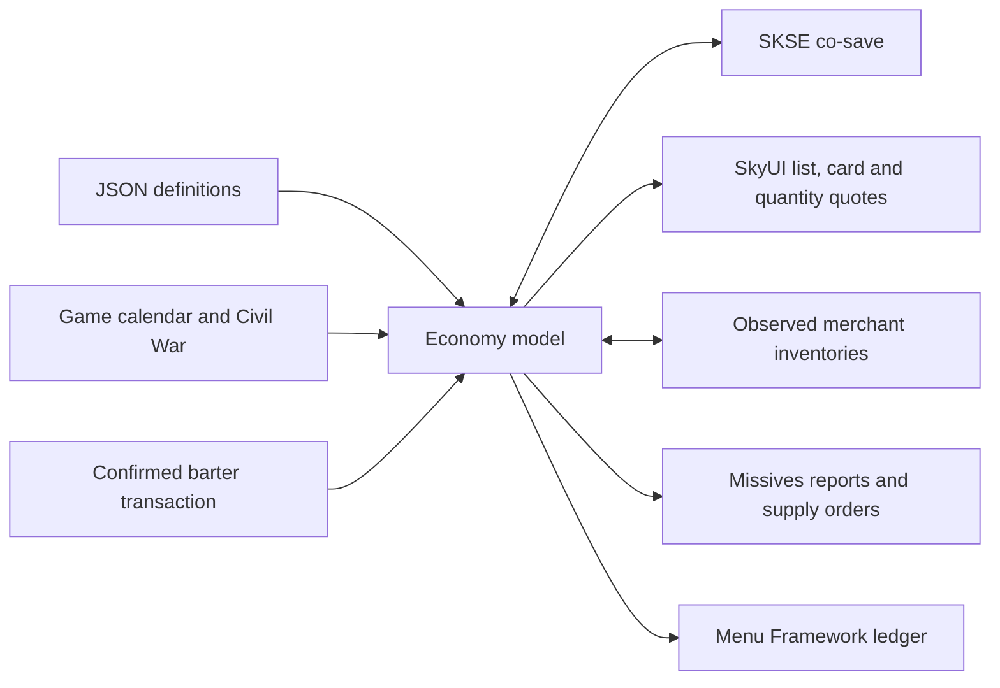

# Architecture

`src/core` is portable C++ with no game dependency. `Economy` owns the complete save-specific state; JSON encoding is versioned and validated before replacing live state. Fixed daily ticks and a serialized xorshift state make catch-up independent of batch size. Terminal contract history is bounded. Unsupported schemas fail rather than reset a running economy.

Schema 2 adds household goods. Loading schema 1 initializes the new commodity at the saved day when it is absent from every market and present in the current definitions. Established goods, prices, merchants, shipments, contracts, time and RNG state are preserved. Existing household stock in custom configurations is retained. Missing established goods, partially missing household stock and invalid values still reject the load without replacing live state. New saves cannot be loaded by pre-0.1.4 DLLs.

Markets contain warehouses; merchant stock is separate. Both contribute to local availability. Production responds to storage, demand responds to price, food can spoil, and recipes consume inputs. Routes reserve stock when departing and deliver later, with losses decided and saved on departure. Taxes and NPC purchasing are explicit outside money sources; merchants spend cash to restock.

Each merchant item separates managed chest quantity from `externalQuantity`, observed in Skyrim's sale inventory through `ExtraOriginalReference` source handles. Shop displays and other sale sources contribute to availability but are never subject to simulated turnover or chest replenishment. The adapter validates the selected sale row's count, lets the engine choose the source, and accounts for the confirmed chest and external portions of the transfer separately. It preserves external counts between transactions because Skyrim's temporary sale inventory is being rebuilt. Opening the next barter session observes the external sources again. Older schema-1 saves default this new count to zero until observation.

The price function integrates stock change at unit midpoints, rounds each unit and sums the result. Symmetric trades retrace the curve before the game's barter spread. One `Price` method supplies all quotes. A confirmed `Trade` updates item counts, merchant cash and regional source/sink totals. There is no quote-time inventory mutation.

`src/runtime` adapts the model to Skyrim. Only game-thread tasks use game objects. A small timer requests work; it does not touch engine state. UI rendering reads a copied snapshot. A generation counter invalidates queued work after changing saves. Runtime form keys store the originating plugin and local ID, so load-order changes do not change identity; dynamic forms are excluded.

The native integration targets 1.6.1170 and uses pinned CommonLib definitions. `BarterMenu::Accept` redirects the `ItemSelect` callback. SkyUI method wrappers and a list data processor provide native quotes. Stock/gold are verified around the original callback; fractional unit-price rounding is reconciled only after observing the complete transfer. A detour on `TESObjectREFR::ResetInventory` protects registered merchant chests from vanilla replenishment. All these boundaries need in-game validation.

Missives uses only owned BOOK records and existing board references. A narrowly filtered description detour renders those notes from current state. Closing a contract note presents native buttons. Contracts persist exact requested forms and names with fixed terms, reserve funds when posted, and settle only once. The Missives adapter is the only runtime source of new offers and contract actions; the Menu Framework ledger displays market information only. No additional quest engine or Papyrus loop is involved.

First-release limits: no per-mine simulation, service-price adapters, NPC household budgets, physical caravans, custom-board discovery, VR or alternate executable support. Commodity classification is broad and configurable; production and demand coefficients are starting balance choices. Plugin interoperability and economic balance are part of the game-test phase.
