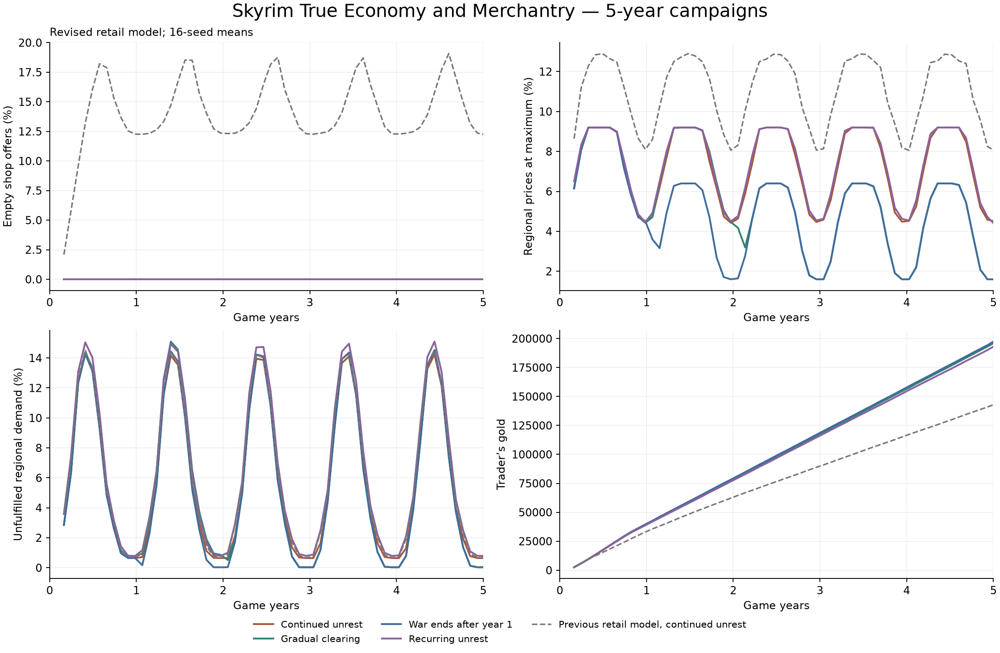

# Five-year campaign experiment — 0.7.0

The expanded simulation stays numerically stable through five game years, but
the first runs exposed permanently empty shop categories. Version 0.7.0 fixes
the consumption and restocking rules behind that problem. Seasonal shortages
and accumulating wealth remain visible in the results.

These are offline experiments using the actual portable economy core. They do
not execute Skyrim's inventory, dialogue, location or save-file adapters.



## Coverage

The read-only location audit examined 763 locations in the five official masters.
Of 83 locations in the relevant categories, 39 have reviewed road associations:

| Category | Candidates | Supported |
| --- | ---: | ---: |
| Bandit camps, caves and mines | 37 | 25 |
| Forsworn sites | 9 | 5 |
| Fort-tagged locations | 10 | 9 |
| Draugr crypts | 27 | 0 |

Bleak Falls Barrow remains an explicit inactive control, giving 40 shipped
profiles. The full audit, including IDs, keywords, coordinates, exclusions and
official-master hashes, is in the source tree at `data/security-coverage.json`.
No game assets or extracted scripts are included. The extractor follows
[xEdit's Skyrim record definitions](https://github.com/TES5Edit/TES5Edit/blob/dev-4.1.6/Core/wbDefinitionsTES5.pas).

Roads retain fixed total threat budgets, divided among associated sites. The
largest possible hostile-only pressure is about 0.668, below the configured
0.8 ceiling. A newly listed camp therefore takes a share of an existing road's
exposure rather than adding another full penalty. Both directions share the
same association. The 26 directed routes and ten regional markets are unchanged.

Coordinates support corridor selection; distance to a capital is not the
runtime formula. The mappings are reviewed approximations, not pathfinding over
Skyrim's road mesh. Several exclusions prevent misleading effects:

- Karthspire lacks `LocTypeClearable`. Ustengrav and Frostmere Crypt have mixed
  ruin/camp characteristics. Their whole-location clear is not a clean signal
  for a road camp.
- The Whiterun watchtower is fort-tagged but is not a Civil War occupation fort.
- Solstheim's inland bandit sites have no local road graph here. Clearing them
  does not protect the Eastmarch sea crossing.
- Remote sites and uncertain map positions remain excluded. Knifepoint Ridge's
  location record points to Robber's Gorge's marker; the catalog explicitly
  substitutes the verified Knifepoint marker for its geographic review.
- Greymoor, Dunstad and Sungard retain their reviewed initial raider occupants.
  Amol, Greenwall, Hraggstad, Kastav, Neugrad and Snowhawk have unknown initial
  occupants and activate only after a recognized military occupation.

Camp profiles now require the clearable keyword at runtime as well as a matching
category. Mod-added locations require explicit profiles. Clearing a site changes
transport conditions, never its mine output, loot or production capacity.

## Experiment

Sixteen seeds, four world histories and four player strategies produced 256
campaigns per retail model: 512 runs and 934,400 simulated days in total. Each
run lasts 1,825 days, including a 30-day warmup. Both models use the same expanded
security definitions and initial seeds. The comparison isolates the retail
changes; it is not a comparison of nine-site versus 39-site coverage.

| World history | Scheduled conditions |
| --- | --- |
| Continued unrest | Raider sites stay hostile; broad war disruption continues |
| Gradual clearing | Sites clear on seeded days 45–694; forts gain garrisons 30 days later; war ends on day 730 |
| War to peace | War ends on day 365; camps clear and forts gain garrisons |
| Recurring unrest | Staggered 180-day camp and fort cycles; broad war disruption continues |

These schedules are hypothetical inputs to the experiment. The mod does not
create random occupations, force clears or assume that respawns reset Skyrim's
cleared flag. Changes take effect on future daily ticks, just as runtime
observations do. The peace scenarios combine several changes and cannot isolate
the effect of clearing alone.

| Player strategy | Activity |
| --- | --- |
| Observer | All shops registered; no player transactions |
| Adventurer | Weekly synthetic loot, travel between holds, sell when the buyer can afford it |
| Trader | Choose a profitable destination using current offers, buy cargo, travel, then sell at the arrival price |
| Explorer | No transactions; register another hold's shops every 30 days |

There are 50 synthetic merchants, five per region, with two item variants for
each of the 25 goods: 500 offers in total. Every merchant starts with 2,000 gold;
the player starts with 1,000. Cash never resets. Cargo is limited to 20 items and
an approximate weight budget of 120. Journeys use the existing route graph and
take game days; the trader does not know future prices.

This trader has perfect knowledge of today's offers and pays no living or travel
expenses. It is a favorable trading scenario, not an expected player income or a
proof of the best possible strategy. The adventurer's weekly loot is deliberately
small and does not represent a full playthrough's dungeon rewards.

## Retail changes

Previously, household consumption took its share before shops could restock.
Where local output stayed below household demand, an empty shop could remain
empty indefinitely. Background shop customers also consumed goods on top of
regional demand, so registering more merchants created more consumers. Finally,
eight items at 8% turnover had only an 8% chance of one sale instead of the
correct expected 0.64 sales.

The revised model counts shop customers within regional demand, rounds fractional
turnover probabilistically, and reserves a bounded share of supply for affordable
shop orders. A fraction of an item can accumulate until a whole item can be
delivered. The most depleted offers restock first. Deliveries still remove actual
warehouse goods and spend merchant cash. Protected and external/display stock
do not participate. Recipes now run after retail and warehouse spoilage, before
dispatch; production coefficients and barter settings are unchanged.

## Results

The table shows final-year observer means across 16 seeds. The final measurement
year has 335 days; the preceding years have 365. Empty offers are sampled after
daily restocking. Ceiling percentages count market/commodity days, not individual
items in Skyrim's barter menu.

| World history | Empty offers, previous → revised | Prices at ceiling, previous → revised | Unmet regional demand, previous → revised |
| --- | ---: | ---: | ---: |
| Continued unrest | 14.66% → 0.00% | 11.18% → 7.46% | 6.50% → 6.19% |
| Gradual clearing | 7.82% → 0.00% | 5.84% → 4.52% | 6.28% → 5.97% |
| War to peace | 7.80% → 0.00% | 5.83% → 4.52% | 6.28% → 5.97% |
| Recurring unrest | 15.16% → 0.00% | 11.38% → 7.58% | 7.18% → 6.85% |

The previous model left 4–16 of the 250 regional commodity categories empty on
at least 99% of sampled days, depending on the world history. None met that
threshold after the fix. Active traders still temporarily depleted offers:
their final-year empty-offer rate was about 0.055%. These measurements show that
supply reaches shelves; they do not promise full inventories or uninterrupted
availability between daily samples.

Prices settled into repeatable seasonal cycles rather than drifting indefinitely.
After peace, the revised mean regional price index was about 6.2% below continued
unrest, and delivered cargo was about 7.8% higher. Those are combined war,
clearing and occupation effects. Individual categories can move the other way
when garrisons add demand or exporters sell more goods.

Registering shops gradually did not permanently shift the economy to another
price level. By the final year, observer/explorer prices differed by an average
of 0.009–0.026% per regional commodity, compared with 0.129–0.137% previously.
Shop registration still brings real stock into the model and can affect early
prices; exact equality is not expected.

| World history | Trader's final gold, mean | Range across seeds | Completed sale visits, mean |
| --- | ---: | ---: | ---: |
| Continued unrest | 198,373 | 196,943–200,568 | 513 |
| Gradual clearing | 197,658 | 196,597–198,579 | 511 |
| War to peace | 198,885 | 197,789–200,435 | 511 |
| Recurring unrest | 194,549 | 192,664–195,856 | 510 |

The revised trader earned more than under the previous retail model, which
finished around 139,000–144,000 gold on average. More goods remained available
to buy, allowing more trips. Wealth grew roughly linearly, rather than exploding
through exponential reinvestment under this cargo limit. Small-load adventurers
finished around 20,000–22,000 gold on average. Passive players retained their
original 1,000 gold exactly.

## Remaining limits and next work

Peace does not resolve every shortage. In the final peace year, Winterhold still
failed to satisfy about 58% of food demand and 55% of grain demand; Solstheim's
grain deficit was about 49%. Seasonal demand/output swings dominate these
shortages. Winterhold armor, Hjaalmarch armor, Winterhold silver and Falkreath
medicine stayed at the price ceiling even though shops received stock.

The next balance work should separate inadequate production, storage losses,
shipping bottlenecks and structural price factors. Tuning those independently
will be more informative than adding another global price multiplier. Shop
target quantities also remain fixed at first observation; adaptation to sales,
larger assortments and more merchants still needs testing.

Material dependencies remain incomplete. Iron can become steel, but weapons and
armor do not require metal, and steel has independent base output too. An iron
shortage therefore does not yet constrain equipment production. Adding proper
input requirements and input costs is a subsequent simulation change, with its
own depletion and recovery tests.

The economy is not a closed monetary system. NPC customers are an outside money
source; modeled merchants have no wages or operating expenses. Their final-year
average cash reached about 62,000–65,000 gold. No restrictive merchant cash cap or
new player expense was introduced to conceal this result. The long-term wealth
problem remains, particularly for a trader who knows every current price.

Fort interpretation still needs live validation, especially with occupation
overhauls. There are no physical caravans, true road blockades, automatic
mod-location coverage or local Solstheim roads in this build.

## Validation

- All nine CTest suites passed with address and undefined-behavior sanitizers.
- Fifteen Python tests passed, including generated coverage consistency and
  binary record extraction checks.
- All seven Windows test executables and both small simulation runs passed under
  Wine. Merchant summaries matched native results exactly. Campaign metrics
  agreed within 1.8e-13; JSON number formatting changed save lengths by at most
  51 bytes across platforms.
- Every campaign checked stock accounting monthly, transaction item/gold
  conservation, and exact same-platform save/load round trips on day 47 and each
  year. The largest revised stock-accounting residual was 1.08e-8 units; the
  largest sampled economy JSON was 191,962 bytes, with at most 468 shipments.
- Diagnostic collection was checked against an unobserved simulation: state and
  RNG were identical. PE exports and hook dispatch passed the pinned alandtse
  CommonLib audit; no runtime version whitelist was added.

A local Release benchmark with 60 merchants and 60 forms each measured 2.42 ms
per daily tick on average, 2.58 ms at the 95th percentile, after a 30-day warmup.
This measures the portable core on the development machine, not game-thread
latency. Save schema 4 and information schema 1 are unchanged. These checks do
not establish that a particular Skyrim installation or save is fault-free.

## Reproduce the revised campaign

```sh
cmake -S . -B build/campaign -G Ninja -DMARCO_BUILD_PLUGIN=OFF -DMARCO_SANITIZERS=OFF -DCMAKE_BUILD_TYPE=Release
cmake --build build/campaign -j 6
ctest --test-dir build/campaign --output-on-failure
python3 tools/build_security.py --check
build/campaign/marco_campaign_sim package/SKSE/Plugins/MarcoPolo/economy.json package/SKSE/Plugins/MarcoPolo/security.json build/campaign-results 16 1825
```

The output directory must be empty. Optional arguments are seed count, total
days and first seed; defaults are 16, 1,825 and 1. The tool writes monthly and
yearly metrics, per-commodity annual data, world events, player trades and a JSON
summary. `tools/analyze_campaign.py` combines paired shards and can draw the
figure with Matplotlib. The committed [aggregate results](results/campaign-0.7.0.json)
contain both models; `before` means the previous retail rules with expanded
coverage, not the complete released 0.6.0 configuration.

To repeat the optional record audit against locally installed official masters:

```sh
python3 tools/catalog_locations.py --data '/path/to/Skyrim Special Edition/Data' --output build/locations.json
```

The audit reads game data without changing it. It does not decide which sites
belong on a trade corridor; those decisions remain in the reviewed catalog.
