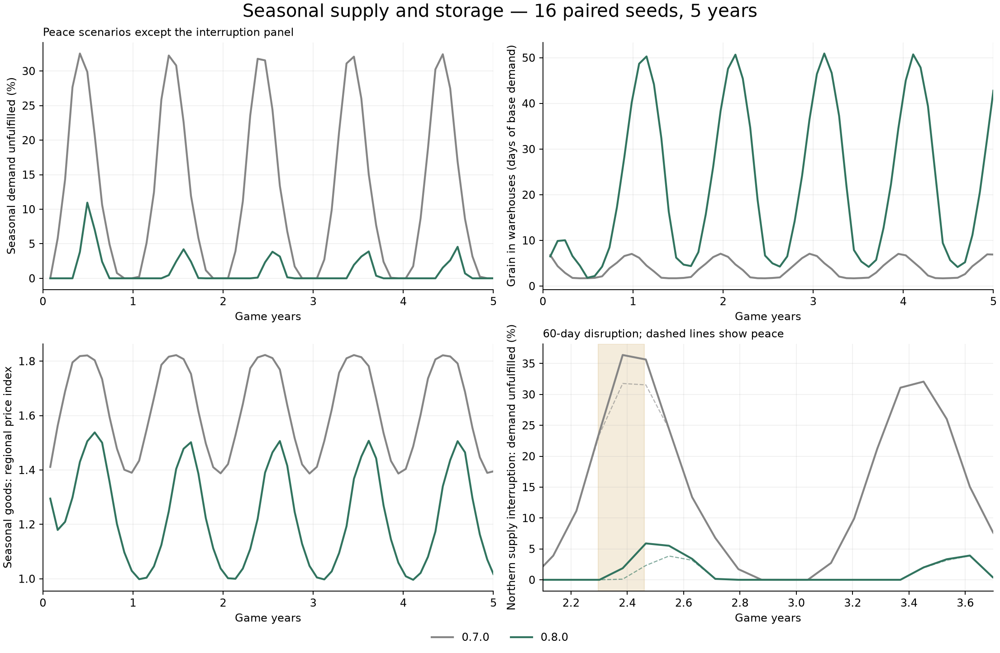

# Seasonal supply and storage — 0.8.0

Markets now build reserves during the productive part of the year and use them
through winter. In the five-year comparison, unmet demand for seasonal goods
fell from 12.60% to 0.79% in peace, while prices retained an annual cycle.
The change improves availability without raising road capacities or changing
regional production coefficients.



## Diagnosis

The previous production curve only reduced output. Even its best season merely
returned production to the configured rate. Warehouses also aimed for ten days
of stock, so producers slowed down before they could build a winter reserve.

Separate three-year, one-seed controls established which constraints mattered.
These percentages cover grain, food, meat and timber in the final peace year:

| Control | Unmet seasonal demand |
| --- | ---: |
| Previous model | 12.59% |
| Four times the freight capacity | 12.60% |
| No warehouse spoilage | 12.07% |
| Four times the ordinary inventory target | 10.91% |
| No seasonal effects | 0.00% |

Larger warehouses alone increased fresh-food losses. The main problem was the
timing and amount of available supply, rather than insufficient road capacity.

## Changes

Production now varies around its configured annual rate. Climate determines the
size of the swing, and each commodity controls its sensitivity. Regional output
coefficients still determine which holds are exporters and importers. Actual
output remains subject to disruption and inventory feedback; a productive season
does not force goods into already full warehouses.

Warehouse targets rise ahead of winter and fall as the lean period progresses.
Production and import orders use these targets. They are plans, not free stock
or hard storage limits: supplies must still be produced or delivered. Starting
stock remains unchanged, and an existing market builds its reserve over time.

| Commodity | Production sensitivity | Reserve allowance |
| --- | ---: | ---: |
| Grain | 1.00 | 120 days |
| Food | 0.40 | 20 days |
| Meat | 0.35 | 5 days |
| Timber | 0.50 | 60 days |

The allowance is multiplied by local climate severity and the seasonal
preparation curve. It is additional to the ordinary target, not a promise of
that many days of stock in every warehouse. Perishable allowances are capped at
one quarter of shelf life. Grain and timber can carry longer reserves; food and
meat receive smaller buffers.

Trade quotes retain the ordinary inventory reference. A planning change alone
therefore does not reprice an unchanged inventory. Exporters also retain their
ordinary local reserve rather than withholding the entire planned winter buffer
from other holds. Incoming shipments count against outstanding orders as before.

The policy uses the existing 365-day economic calendar. It does not read local
weather or introduce new world events. Price bounds, barter settings, road
capacities, regional base output, demand coefficients and spoilage rates are
unchanged.

## Experiment

The seasonal experiment ran 16 paired seeds for five complete years in four
scenarios: 64 campaigns per model, 128 runs in total. It used all ten markets,
25 commodities and 50 synthetic merchants with two item variants per commodity.
Each merchant began with 2,000 gold. No player traded in this experiment, so
production, consumption, transport and storage can be compared directly.

Peace begins with camps cleared and military forts occupied. Continued unrest
retains hostile camps and the existing broad war disruption. Two additional
scenarios introduce a 60-day interruption in the Pale, Hjaalmarch and Winterhold
during the third year, once in winter and once in summer. Affected production
falls 42%, connecting road capacity falls 45%, and delays and transport risk
increase. These interruptions are hypothetical test inputs, not events added to
the live game.

The first year starts with the ordinary ten-day inventory, allowing the test to
measure reserve buildup. Results below use complete 365-day years; they do not
use the campaign harness's shorter final measurement year.

## Results

| Scenario and measurement period | Unmet seasonal demand, 0.7.0 → 0.8.0 |
| --- | ---: |
| Peace, fifth year | 12.60% → 0.79% |
| Continued unrest, fifth year | 12.74% → 0.90% |
| Winter interruption, affected third year | 13.39% → 1.42% |
| Summer interruption, affected third year | 12.80% → 0.80% |

The first peace year still had 2.06% unmet demand while reserves accumulated.
From the second year onward it stayed around 0.8%. Warehouse stocks rose and
fell with the seasons instead of growing without limit. Aggregate grain storage
peaked at roughly 51 days of base demand, compared with about seven previously.

The winter interruption still caused a shortage, but the economy recovered.
In the following year, unmet demand was only 0.022 percentage points above its
peace comparison. The summer interruption reduced the next winter's reserves;
the following year's difference was 0.086 percentage points. By the fifth year,
both were within 0.015 percentage points of peace.

Among seasonal goods, the share of regional prices at the ceiling fell from
16.85% to 2.38%. The floor was reached on 0.63% of sampled market/commodity days.
The unweighted regional price index fell from 1.625 to 1.211, with higher winter
prices and cheaper supplies during reserve buildup. Shop offers remained
available at the daily samples, preserving the previous retail fix.

The worst remaining peace-year shortfalls were Winterhold food at 11.76% and
Solstheim grain at 5.37%. These are annual demand deficits, not the percentage
of days a player-facing shop is empty. Import-dependent markets still carry risk.

More storage has a cost. Warehouse spoilage rose from 3.42% to 5.76% of total
seasonal production. For food alone it rose from 4.49% to 8.71%; for meat,
6.42% to 10.13%. Durable goods retain their zero-spoilage configuration. The
perishable limit prevents much larger stockpiles, but does not eliminate waste.

Reserve deliveries also make roads busier. Whiterun–Pale averaged 75.1% of
available capacity, up from 38.1%, and reached capacity on 43.4% of days.
The largest increase in any nonseasonal category's unmet demand was less than
0.05 percentage points in the final peace year. The measured improvement did
not come from a substantial transfer of shortages to other goods.

## Player campaigns

The separate campaign harness repeated all 256 five-year world/player runs,
matched against the saved 0.7.0 results. This includes active traders,
adventurers and gradual merchant discovery.

| World history | Total unmet demand, final measurement year | Trader's final gold, 0.7.0 → 0.8.0 |
| --- | ---: | ---: |
| Continued unrest | 6.19% → 1.03% | 198,373 → 199,358 |
| Gradual clearing | 5.97% → 0.42% | 197,658 → 198,079 |
| War to peace | 5.97% → 0.41% | 198,885 → 199,101 |
| Recurring unrest | 6.85% → 1.41% | 194,549 → 195,848 |

These demand figures include all commodities. The trader starts with 1,000 gold,
knows current offers and pays no expenses. Its final gold changed by less than
1% in every world history. The established route-profit and local-resale checks
also passed. This balance pass improves supply without solving long-term wealth
accumulation.

## Validation and compatibility

All ten CTest suites passed under address and undefined-behavior sanitizers.
All eight Windows test executables and three small simulation runs passed under
Wine, and all 15 Python tests passed. Windows seasonal metrics matched native
results within 1.1e-9 units; other simulation metrics differed only at floating
point precision. PE exports and the pinned CommonLib hook audit passed.

New checks cover annual production potential, reserve timing, lean-season
coverage, perishable limits, continued exports, conservation, unchanged quotes
before inventory changes, policy updates and deterministic catch-up. All long
runs checked stock accounting and annual save/load round trips. The largest
stock-accounting residual was 1.15e-8 units. The largest sampled economy JSON
was 202,864 bytes, with at most 552 shipments in the campaign runs.

A local Release benchmark with 60 merchants and 60 forms each averaged 2.56 ms
per daily tick, with a 2.70 ms 95th percentile. It measures the portable core,
not game-thread latency.

Save schema 4 is unchanged. Existing stocks, prices, merchants and cargo load
without a reset. The new settings are `policy.balancedSeasons` and commodity
fields `productionSwing` and `reserveDays`. Older configurations default to the
previous behavior. A three-year run with the old configuration matched the old
executable's output exactly. The tests do not execute Skyrim's save or inventory
adapters; live validation remains necessary.

## Reproduce

```sh
cmake -S . -B build/seasonal -G Ninja -DMARCO_BUILD_PLUGIN=OFF -DMARCO_SANITIZERS=OFF -DCMAKE_BUILD_TYPE=Release
cmake --build build/seasonal -j 6
ctest --test-dir build/seasonal --output-on-failure
git show 7869a1a:package/SKSE/Plugins/MarcoPolo/economy.json > build/economy-0.7.0.json
build/seasonal/marco_season_sim build/economy-0.7.0.json package/SKSE/Plugins/MarcoPolo/security.json build/seasonal-before 16 5
build/seasonal/marco_season_sim package/SKSE/Plugins/MarcoPolo/economy.json package/SKSE/Plugins/MarcoPolo/security.json build/seasonal-after 16 5
python3 tools/analyze_seasons.py --before build/seasonal-before --after build/seasonal-after --output build/seasonal-comparison.json --plot build/seasonal-comparison.png
```

Output directories must be empty. Optional simulator arguments are seed count,
years, first seed and scenario (`all`, `peace`, `unrest`, `winter_disruption` or
`summer_disruption`). It writes annual and monthly commodity flows, road use and
validation metadata. The analyzer requires Matplotlib only when drawing a plot.

The committed [seasonal results](results/seasons-0.8.0.json) and
[player-campaign comparison](results/season-campaign-0.8.0.json) contain both
models' aggregate measurements.
